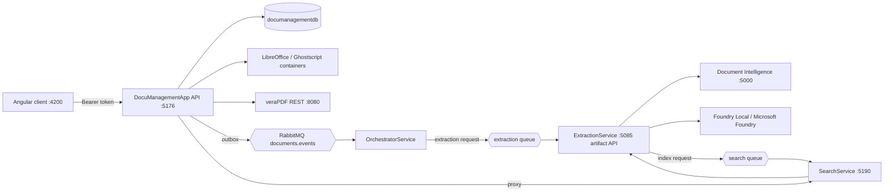
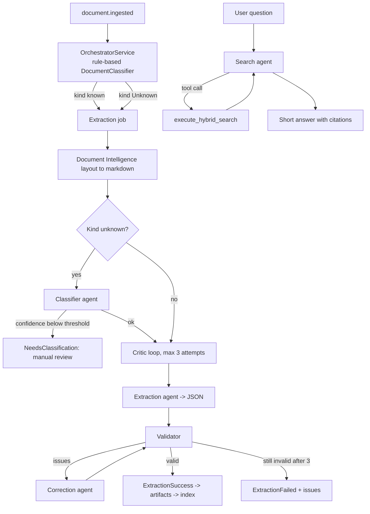

# Document Management System (DMS)

An event-driven document management platform: upload documents, convert them to PDF / PDF/A, archive them, classify and extract structured data, index them for search, and review/edit them as versioned revisions. Access is protected with Microsoft Entra ID (OIDC + role-based access control).

## Features

- **Upload & storage** – authenticated upload, list and download of documents (PostgreSQL metadata + file storage keyed by document GUID).
- **Office → PDF conversion** – LibreOffice (container) converts Office documents to PDF.
- **PDF/A conversion & validation** – Ghostscript (container) produces PDF/A-2b; veraPDF (REST) validates compliance.
- **Revisions** – every edit is saved as a new revision; list, download and restore earlier versions.
- **Classification & orchestration** – `OrchestratorService` classifies documents (invoice, contract, identity, financial statement, …) and routes them.
- **Extraction** – `ExtractionService` uses Azure Document Intelligence plus an LLM agent (Foundry Local or Microsoft Foundry) with a critic loop and validators (e.g. invoice validation).
- **Search** – `SearchService` chunks, embeds and indexes content; deterministic, hybrid and agentic search endpoints.
- **Agentic AI** – LLM agents classify unknown documents, extract and self-correct structured data, and answer search questions with tool calls and citations (see [Agentic AI](#agentic-ai)).
- **RBAC** – roles Viewer / Contributor / Reviewer / Admin enforced by the API and reflected in the UI.
- **Reliable messaging** – transactional outbox in each service, RabbitMQ with dead-letter queues.

## Architecture



### Pipeline

1. **Upload** – `POST /api/fileupload/upload` stores the file; `DocumentIngestionService` writes the record and an outbox message in one transaction.
2. **Conversion** – Office files go through LibreOffice (`OfficeToPdfConversionService`); PDFs can be converted to PDF/A with Ghostscript and validated with veraPDF (`GhostscriptVeraPdfAProcessingService`, `/api/pdfa/*`).
3. **Archiving/storage** – `DocumentStorageService` stores files under the document GUID; revisions are kept in `DocumentRevisions`.
4. **Publish** – `OutboxPublisher` publishes `document.ingested` to exchange `documents.events` (publisher confirms, retry with backoff).
5. **Orchestrate** (rule-based, see [Agentic AI](#agentic-ai)) – `OrchestratorService` consumes `orchestrator.document-ingested`, classifies by file name/content type (`DocumentClassifier`) and emits extraction requests via its own outbox.
6. **Extract** – `ExtractionService` fetches the document from the API (`DocumentContentApi`), runs layout extraction, optional model extraction, the critic loop and validators, stores artifacts and serves them on its artifact API.
7. **Index & search** – `SearchService` reads artifacts, chunks (`SearchChunker`), creates embeddings and stores them in `searchdb`.

### Backend projects

| Project | Role | Default URL | Database |
|---|---|---|---|
| `DocuManagementApp` | REST API, conversion, storage, revisions, auth, search proxy | http://localhost:5176 | `documanagementdb` |
| `OrchestratorService` | Consumes ingest events, classifies, routes | – (worker) | `orchestratordb` |
| `ExtractionService` | Extraction agent + artifact API | http://localhost:5085 | `extractiondb` |
| `SearchService` | Chunking, embeddings, search API | http://localhost:5190 | `searchdb` |
| `DocuManagementApp.Tests` | Unit tests | – | – |

## Agentic AI

The DMS combines **deterministic code** (routing, validation, persistence, messaging) with **LLM agents** where judgement or language understanding is needed. The principle: the agent proposes, deterministic code verifies and decides. All model access uses OpenAI-compatible endpoints, either local (Foundry Local / Ollama) or hosted (Microsoft Foundry).



### OrchestratorService – deterministic routing (no LLM)

`OrchestratorService` is the decision layer, and intentionally **not** model-driven. `DocumentClassifier.Classify(fileName, contentType)` maps file-name keywords (invoice/bill, contract/agreement/nda, passport/identity/driver-license, financial-statement/annual-report/balance-sheet) to a `DocumentKind` and otherwise falls back on content type or extension (Pdf, Image, Spreadsheet, Text, Unknown). It then emits an extraction request through its outbox. This keeps routing cheap, predictable and testable; documents it cannot classify (`Unknown`) are handed to the classifier agent in ExtractionService, which sees the actual content.

### ExtractionService – the agentic core

`FoundryDocumentAgent` implements three agent roles against the configured model:

| Role | Interface | Purpose |
|---|---|---|
| Classifier | `IDocumentClassifierAgent` | Reads the first ~6000 characters of the document markdown and returns `{kind, confidence, reason}` as JSON. Treats the document as untrusted data (prompt-injection guard). Invalid JSON or unsupported kinds become `Unknown` with confidence 0. |
| Extractor | `IDocumentExtractionAgent` | Produces candidate JSON for the document kind, following the schema in `DocumentExtractionSchemas`. |
| Corrector | `IDocumentCorrectionAgent` | Receives the markdown, the previous candidate and the validator's issues, and returns a fixed candidate. |

Processing in `ExtractionJobProcessor`:

1. Layout extraction (Azure Document Intelligence) produces markdown.
2. If the kind is not already a supported structured kind, the classifier agent proposes one. If its confidence is below `ClassificationConfidenceThreshold` (default 0.7) or the kind is unsupported, the job ends as `NeedsClassification` for manual review instead of guessing.
3. `DocumentCriticLoop` runs a **generate → validate → correct** loop (`MaximumAttempts = 3`): extract, validate with `DocumentExtractionValidator`, and if issues exist feed them back to the corrector. The result is `ExtractionSuccess` (valid JSON) or `ExtractionFailed` (last candidate plus remaining issues).
4. The outcome is stored as artifacts and an index request is published.

Model extraction is opt-in (`EnableModelExtraction`, default `false`); startup validation fails if it is enabled but no model is configured.

### SearchService – embeddings, hybrid and agentic search

- **Embeddings** – `SearchChunker` splits artifacts into chunks, a text-embedding model (`Embeddings:*`) vectorises them, and `SearchIndexConsumer` stores them in `searchdb`.
- **Deterministic** (`/api/search/deterministic`) – exact filters only; **Hybrid** (`/api/search/hybrid`) – semantic similarity combined with filters.
- **Agentic** (`/api/search/agentic`) – `AgenticSearchService` runs a *tool-calling agent* (`DocumentSearchAgent`) that turns a natural-language question into a search and answers from the results:
  - It has exactly **one tool**, `execute_hybrid_search` (`semanticQuery`, optional `documentKind`, `entityName`, `dateFrom`, `dateTo`, `limit`).
  - It converts relative dates ("last month") into ISO `yyyy-MM-dd` filters using the current date supplied with each request.
  - Tenant identity stays implicit; the agent can neither request nor produce a tenant ID, and it cannot write SQL or call other services.
  - The tool-call budget is `MaximumToolCalls` (default 2, range 1–5); once reached, the tool tells the agent to answer only from results already returned.
  - Answers must be grounded in returned chunks, cite source URL and page, and be at most two sentences; if nothing is found it says no matching documents were found.
  - With provider `OpenAICompatible` the Microsoft Agent Framework drives the loop; with `FoundryLocal` the service runs a manual tool-calling loop (`role=tool` messages).
  - If agentic search is disabled or its endpoint/model or the embedding endpoint is not configured, an `AgenticSearchUnavailableException` is raised, so use the hybrid endpoint instead.

### Agent configuration

| Setting | Service | Meaning |
|---|---|---|
| `EnableModelExtraction` | Extraction | Turns the extraction/classifier/corrector agents on. |
| `ClassificationConfidenceThreshold` | Extraction | Minimum classifier confidence (default 0.7). |
| `Foundry:Provider` | Extraction | `FoundryLocal` (default, `http://localhost:5273/v1/`) or `MicrosoftFoundry` (`Endpoint`, `DeploymentName`, `ApiKey`). |
| `Embeddings:Provider/Endpoint/ModelName/ApiKey` | Search | `FoundryLocal`, `Ollama` or `MicrosoftFoundry`; empty endpoint = embeddings disabled. |
| `AgenticSearch:Enabled/Provider/Endpoint/ModelName/ApiKey/MaximumToolCalls` | Search | Chat model for the search agent (`OpenAICompatible` or `FoundryLocal`). |

Keep API keys in user secrets or environment variables, not in `appsettings.json`.

### Agent safety and limitations

- Agents never write to the database directly: output is validated JSON, and the search agent only calls a read-only search tool scoped to the tenant.
- Model output is non-deterministic and costs tokens/time; low-confidence classifications and failed extractions are surfaced rather than silently accepted.
- The local or hosted model must be running/reachable, otherwise extraction jobs retry/fail and agentic search is unavailable.
- Edited revisions are not re-extracted or re-indexed automatically.

### API overview

| Endpoint | Policy |
|---|---|
| `POST /api/fileupload/upload`, `GET /api/fileupload/files`, `GET /api/fileupload/download/{id}`, `POST /api/fileupload/{id}/convert-to-pdf` | authenticated |
| `/api/pdfa/generate \| convert \| validate \| suggestions \| last-report` | authenticated |
| `GET /api/documents/{id}/revisions`, `GET …/{n}/content` | `DmsRead` |
| `POST /api/documents/{id}/revisions` | `DmsWrite` |
| `POST …/{n}/restore` | `DmsReview` |
| `POST /api/search/deterministic \| hybrid \| agentic` | authenticated |

### Frontend (`angClientapp`)

Angular 21 (standalone components, Vitest), MSAL (`@azure/msal-angular`). An MSAL interceptor attaches the bearer token to `http://localhost:5176/api/*` (`protectedResourceMap`). Features: file upload and list (with "Verlauf / Bearbeiten" link), revision history/editor, search. Authenticated downloads are fetched as blobs, because a plain `<a href>` cannot send a bearer token.

### Authentication & RBAC

- API: Microsoft.Identity.Web JWT bearer, `MapInboundClaims=false`, `RoleClaimType="roles"`.
- Policies: `DmsRead`, `DmsWrite`, `DmsReview`, `DmsAdmin`.
- Entra app registration (`DocumentManagementApp`): identifier URI `api://<ClientId>`, scope `access_as_user`, SPA redirect URI `http://localhost:4200/`, app roles `Viewer`, `Contributor`, `Reviewer`, `Admin` (assign users in *Enterprise applications → Users and groups*).
- Client scope: `api://<ClientId>/access_as_user`. Do **not** set `AzureAd:Audience` on the API.

## Prerequisites

- .NET 9 SDK, `dotnet-ef` tool (`dotnet tool install -g dotnet-ef`)
- Node.js LTS and Angular CLI (`npm i -g @angular/cli`)
- Docker or Podman
- PostgreSQL 16+ (pgvector recommended for embeddings)
- RabbitMQ (provided by `compose.yaml`)
- veraPDF REST service on `:8080`
- Optional: Foundry Local / Microsoft Foundry, Azure Document Intelligence (or a compatible container on `:5000`)

## Configuration

Keep secrets out of source control; use user-secrets or environment variables (`ConnectionStrings__DefaultConnection`, `RabbitMq__UserName`, …).

| Service | Key settings |
|---|---|
| API | `AzureAd` (TenantId, ClientId), `ConnectionStrings:DefaultConnection`, `PdfA` (container runtime, `GhostscriptImage`, `VeraPdfRestBaseUrl`), `LibreOffice`, `RabbitMq` (host, exchange `documents.events`, outbox tuning, UserName/Password), `SearchProxy` (Enabled, BaseUrl, ApiKey) |
| Orchestrator | `ConnectionStrings:Orchestrator`, `RabbitMq` (queues, dead-letter, credentials) |
| Extraction | `ConnectionStrings:Extraction`, `ExtractionArtifactApi`, `DocumentContentApi:BaseUrl`, `DocumentIntelligence`, `Foundry`, `ExtractionProcessing`, `RabbitMq` |
| Search | `ConnectionStrings:Search`, `Search` (ListenUrl, ApiKey, TenantId, SourceDocumentBaseUrl), `ArtifactApi:BaseUrl`, `Embeddings`, `AgenticSearch`, `Search:RabbitMq` |

Example:

```powershell
cd DocuManagementApp
dotnet user-secrets set "ConnectionStrings:DefaultConnection" "Host=localhost;Port=5432;Database=documanagementdb;Username=postgres;Password=<pw>"
dotnet user-secrets set "RabbitMq:UserName" "dms"
dotnet user-secrets set "RabbitMq:Password" "<pw>"
```

Angular: set the tenant, client ID, API scope and API base URL in the MSAL configuration under `angClientapp/src/app`.

## Postgres databases

`compose.yaml` starts Postgres and creates `orchestratordb` and `extractiondb` on first start (`db/init/01-create-databases.sql`). The services create their own tables on startup.

```powershell
# .env (not committed): POSTGRES_PASSWORD=<your password>
docker compose up -d postgres
cd OrchestratorService
dotnet user-secrets set "ConnectionStrings:Orchestrator" "Host=localhost;Port=5432;Database=orchestratordb;Username=postgres;Password=<pw>"
cd ..\ExtractionService
dotnet user-secrets set "ConnectionStrings:Extraction" "Host=localhost;Port=5432;Database=extractiondb;Username=postgres;Password=<pw>"
```

Without Docker, run `CREATE DATABASE orchestratordb; CREATE DATABASE extractiondb;` on your own Postgres.

## Setup & run

1. **RabbitMQ**
   ```powershell
   $env:RABBITMQ_DEFAULT_USER="dms"; $env:RABBITMQ_DEFAULT_PASS="<pw>"
   docker compose up -d rabbitmq      # AMQP 5672, management UI http://localhost:15672
   ```
2. **PostgreSQL** – start it and create `documanagementdb`, `orchestratordb`, `extractiondb`, `searchdb`.
3. **veraPDF REST** – run a veraPDF REST container publishing port 8080. Pull the Ghostscript and LibreOffice images once (`docker pull docker.io/minidocks/ghostscript:latest docker.io/linuxserver/libreoffice:latest`).
4. **Migrations** (API; workers create/migrate their schema on start-up as configured)
   ```powershell
   cd DocuManagementApp; dotnet ef database update
   ```
5. **Start services** (one terminal each; start order: API → Orchestrator → Extraction → Search)
   ```powershell
   dotnet run --project DocuManagementApp        # :5176
   dotnet run --project OrchestratorService
   dotnet run --project ExtractionService        # :5085
   dotnet run --project SearchService            # :5190
   ```
   To enable search from the UI set `SearchProxy:Enabled=true` in the API.
6. **Frontend**
   ```powershell
   cd angClientapp; npm install; ng serve        # http://localhost:4200
   ```

### Keeping it running

- RabbitMQ: `restart: unless-stopped` in compose (or `docker compose up -d`) keeps the broker and its `rabbitmq-data` volume alive across reboots.
- Services: use `dotnet watch run` during development, or publish (`dotnet publish -c Release`) and run as Windows Services / systemd units / containers with automatic restart. Messages are durable and outboxes retry, so workers can be restarted without data loss.
- VS Code `.vscode/launch.json` contains "Attach to …" configurations for debugging.
- Stop a running API before `dotnet build` (the running exe is locked).

## Tests

```powershell
dotnet test DocuManagementApp.Tests
cd angClientapp; ng test
```

## Troubleshooting

- **401** – no bearer token sent: check `protectedResourceMap` and that the API scope is `api://<ClientId>/access_as_user`.
- **403** – user has no app role: assign a role in Entra, sign out/in; confirm the token's `roles` claim.
- **Revision endpoints fail** – run `dotnet ef database update`.
- **PDF/A fails** – verify container runtime path, images and veraPDF at `:8080`.
- **Messages stuck** – inspect RabbitMQ UI and the `*.dead-letter` queues.

## Known limitations

- Saving a revision does not yet trigger re-indexing/re-extraction.
- Worker services do not receive the user token; they use service-to-service API keys.
- The Angular production bundle exceeds its size budget (warning only).
